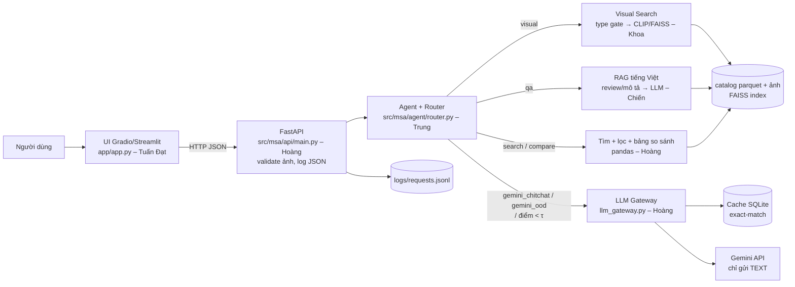

# US_40 – Kiến trúc demo & API contract

| Mục | Nội dung |
|---|---|
| Mã US | US_40 (Owner: Trung, Support: Hoàng) |
| Mục tiêu | Chốt kiến trúc UI → API → Agent router → [công cụ nội bộ \| nhánh Gemini + cache] → dữ liệu, và định dạng request/response từng endpoint để Tuần 3 code song song |
| Đầu ra | file này + `docs/openapi_contract.yaml` (OpenAPI 3.1, 5 endpoint, ví dụ dùng SP thật) |
| Tiêu chí nghiệm thu | Mỗi endpoint có ví dụ request/response; cả nhóm đọc và đồng ý; có sơ đồ quyết định route + τ mặc định |
| Trạng thái | **Khung sẵn** – ví dụ dùng SP thật; số `score/confidence/latency` trong ví dụ là **minh hoạ định dạng, không phải số đo**. Chờ cả nhóm duyệt (N14) |

## 1. Sơ đồ thành phần


## 2. Sơ đồ quyết định route và ngưỡng τ mặc định
```mermaid
flowchart TD
  A[Request: text?, image?, session] --> B{Có ảnh?}
  B -- có --> V[visual: type gate → FAISS top-K]
  V --> V1{cos top-1 ≥ τ_v theo model?<br/>đọc indexes/model/config.json}
  V1 -- có --> VR[Trả top-K, lưu last_results]
  V1 -- không --> VN[“Chưa thấy SP giống” + gợi ý mô tả bằng chữ<br/>KHÔNG gửi ảnh cho Gemini]
  B -- không --> R[Router luật: chuẩn hoá bỏ dấu/teencode → điểm 5 ý định<br/>+ ngữ cảnh: SP đang xem, kết quả vừa tìm]
  R --> C{confidence ≥ τ_intent = 0.6?}
  C -- không --> CL{Đã hỏi lại trong phiên?}
  CL -- chưa --> Q[clarify: hỏi lại 1 lần]
  CL -- rồi --> G
  C -- có --> T{route}
  T -- qa --> QA[RAG theo product_id] --> QA1{retrieval ≥ τ_r? (hiện 0.0)}
  QA1 -- có --> QAR[Trả lời có trích nguồn]
  QA1 -- không --> QAN[“Chưa có thông tin” – Gemini KHÔNG bù dữ kiện SP]
  T -- search --> S[Lọc metadata + xếp hạng]
  T -- compare --> CP{2-3 SP cùng product_type?}
  CP -- có --> CPR[Bảng thuộc tính từ DB]
  CP -- không --> Q
  T -- gemini_chitchat / gemini_ood --> G[LLM Gateway: cache → Gemini<br/>system prompt cấm giá/size/tồn kho]
  G --> PC{Hậu kiểm regex I18:<br/>có giá/size/tồn kho/khuyến mãi?}
  PC -- có --> PCR[Thay bằng câu an toàn]
  PC -- không --> GR[Trả lời, source = gemini/cache]
```
Luật cứng: (1) có ảnh → luôn `visual`; (2) có `product_id` trong ngữ cảnh + câu hỏi → `qa`, không đẩy sang Gemini trừ khi retrieval rỗng (R14); (3) so sánh khác nhóm (áo với giày) → hỏi lại (R19); (4) Gemini lỗi/429/timeout → thông điệp dự phòng, `source=fallback` – UI hiện "Thông báo hệ thống" (R12; sửa theo `00_Chung/QUYET_DINH_CAN_CHOT.md` mục D, trước đây ghi `internal` sẽ làm UI hiện nhầm "Từ dữ liệu cửa hàng").

| Ngưỡng | Giá trị mặc định | Ý nghĩa | Hiệu chỉnh |
|---|---|---|---|
| `τ_v` | ~~0.25~~ → **theo model** (FashionCLIP 0,7039; DINOv2-S 0,5923; SigLIP 0,7531 – `04_Khoa/results/tau_v_analysis.json`) | cosine top-1 tối thiểu của visual search | Khoa đã đo: 0,25 loại 0 % ảnh ngoài phạm vi với cả 5 model → bỏ (QUYET_DINH mục C) |
| `τ_r` | ~~0.35~~ → **0.0** (Chiến) | điểm retrieval tối thiểu của RAG | Với τ_r = 0,35 chặn nhầm 60 % câu có đáp án (`03_Chien/results/rag_retrieval_eval.json`) → từ chối giao cho LLM + guard |
| `τ_intent` | 0.6 | độ tin cậy router; dưới ngưỡng → hỏi lại 1 lần rồi Gemini | Trung, I17 – quét trên eval_router |

## 3. Định dạng response chung (mọi endpoint)
```json
{"route": "visual|qa|search|compare|gemini_chitchat|gemini_ood|clarify",
 "confidence": 0.0, "source": "internal|gemini|cache",
 "answer": "text tiếng Việt", "items": [{"product_id": "...", "title": "...", "price": null, "score": 0.0, "image": "..."}],
 "citations": [{"product_id": "...", "field": "description|review|specs", "chunk_id": "..."}],
 "latency_ms": 0, "request_id": "uuid"}
```
- `price` là `null` khi nguồn không có giá (toàn bộ dữ liệu hiện tại) – UI hiển thị “chưa có giá”, không suy đoán.
- `source=gemini|cache` → UI hiện nhãn **"Trả lời bởi Gemini – thông tin tham khảo chung"**; `internal` → **"Từ dữ liệu cửa hàng"**.
- Mỗi request ghi 1 dòng JSON vào `logs/requests.jsonl` (request_id, route, confidence, source, latency_ms, tokens_in/out nếu có; **không ghi key, không ghi ảnh**).

## 4. Endpoint (chi tiết + ví dụ: `docs/openapi_contract.yaml`)
| Endpoint | Vào | Ra (ngoài khung chung) | Công cụ |
|---|---|---|---|
| `POST /search/image` | multipart `image` (jpg/png/webp ≤ 5 MB), `k`, `product_type?`, `session_id?` | `items` + `type_gate {product_type, conf}` | Visual Search |
| `POST /search/text` | `query`, `filters {product_type, sub_category, color, price_min, price_max, size, gender}`, `k` | `items`, `parsed_filters` | Search |
| `POST /qa` | `question`, `product_id` | `answer`, `citations`, `retrieval_score`, `refused` | RAG |
| `POST /compare` | `product_ids` (2-3, cùng product_type) | `table` (thuộc tính × SP, lấy từ DB), `answer` (LLM chỉ diễn giải bảng) | Compare |
| `POST /chat` | `text?`, `image_b64?`, `session_id` | khung chung; tự route | Agent.handle |

## 5. Giao diện module (gọi chéo – tên cố định)
| Module | Owner | Hàm |
|---|---|---|
| `msa.agent.router` | Trung | `Router.route(text, image, session) -> {route, confidence, needs_clarification}`; `Agent.handle(text, image, session) -> response chung` |
| `msa.agent.session_memory` | Trung | `resolve_product_ref`, `resolve_compare_refs`, `SessionMemory.get/record` |
| `msa.llm_gateway` | Hoàng | `LLMGateway.generate(prompt, system=None, **kw) -> {answer, source, cached, tokens_in, tokens_out, latency_ms, error}` |
| `msa.search.visual` | Khoa | `VisualSearcher.search(image, k=10, product_type=None)`, `type_gate(image)` |
| `msa.rag` | Chiến | `RAGPipeline.answer(question, product_id) -> {answer, citations, retrieval_score, refused}` |
| UI | Tuấn Đạt | gọi `/chat` qua HTTP, hiện nhãn nguồn |

Agent nhận công cụ qua `Tools(visual=..., qa=..., search=..., compare=...)` và LLM qua Protocol `LLMGateway` → ghép code không cần import chéo lúc test.

## 6. Hạn chế dữ liệu ảnh hưởng kiến trúc (đo thật – xem US_26)
- Ảnh FPI chỉ **60×80** → visual search trên ảnh người dùng độ phân giải cao sẽ bị domain gap (R7).
- Không có giá/size trong cả hai nguồn → bộ lọc giá/size của `/search/text` hiện **không có dữ liệu để lọc**; bảng so sánh chỉ có màu, loại, giới tính, mùa, mục đích dùng, rating (ViMRHP).
- Mũ: 285 SP có ảnh sau taxonomy + làm sạch (thiếu quota 300 – xem QUYET_DINH mục A; bản trước ghi 286), không có bucket, wide_brim chỉ 6 SP → type gate cho headwear cần thận trọng.
